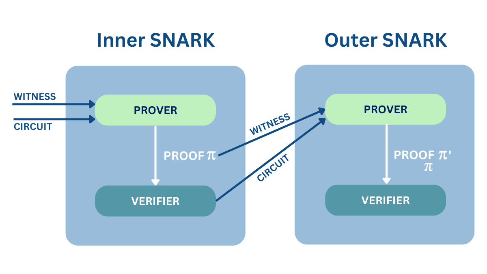
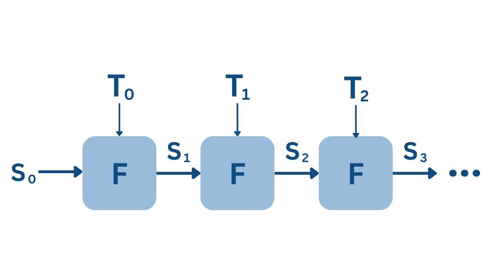
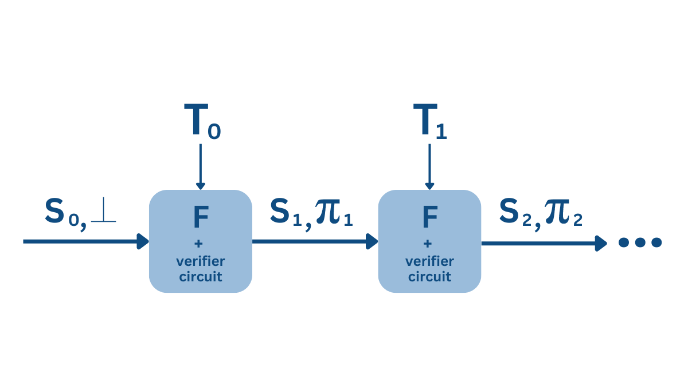
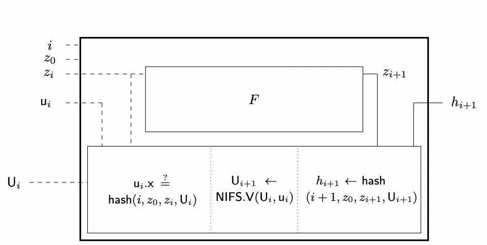
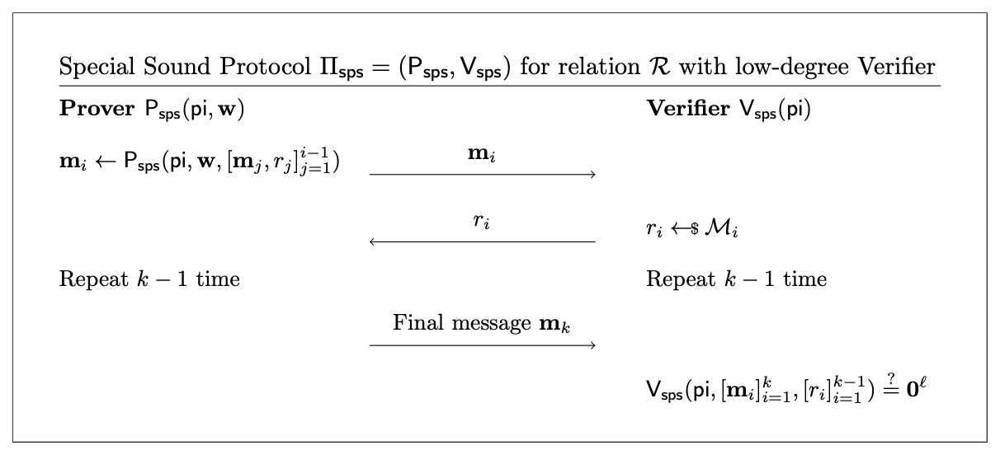
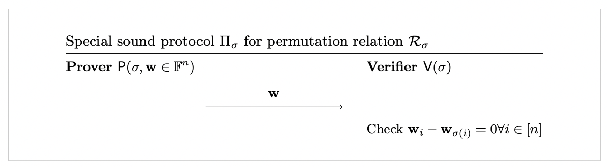
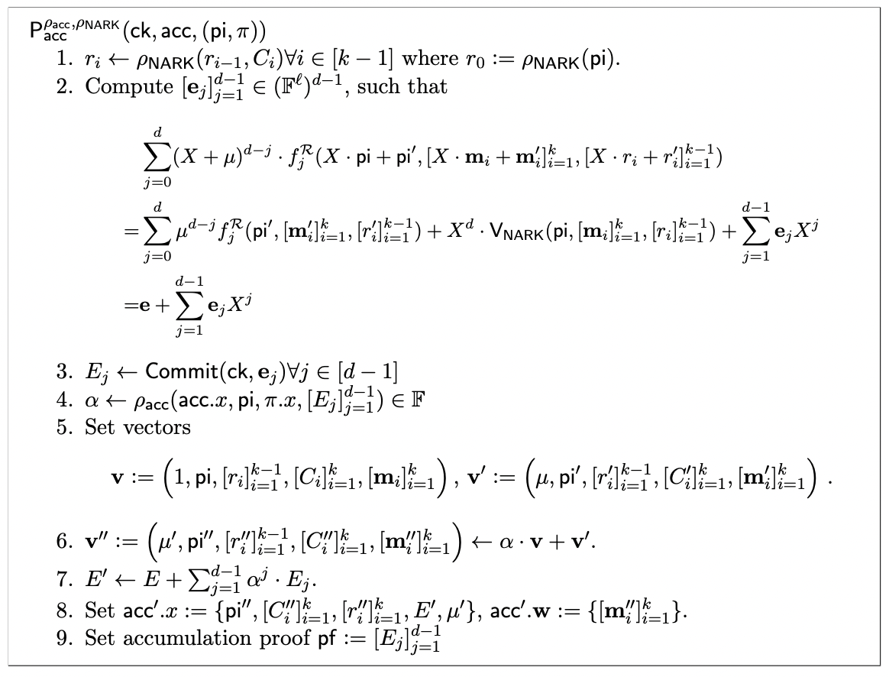

Incrementally Verifiable Computation (IVC) is a way to prove a long, repeated computation without waiting until the end and without rebuilding a proof from scratch at every step. This post follows that idea from Halo's accumulation through Nova's folding schemes, and then to HyperNova and ProtoStar.

# Incrementally Verifiable Computation

A common pattern is to prove a long computation with an inner SNARK that is fast to prove, then wrap it in an outer SNARK that produces a short proof and is fast to verify.

Consider a computation that repeatedly applies a function $F$:

$$s_n = F^{(n)}(s_0)$$

or, more precisely, with a per-step input $T_i$,

$$s_{i+1} = F(T_i, s_i) \quad \text{for } i = 0, \ldots, n-1,$$

$$s_n = F(T_{n-1}, F(T_{n-2}, F(\ldots F(T_1, F(T_0, s_0))))).$$

We may want a proof that this computation was carried out correctly. If the number of iterations is huge, the computation itself becomes very long, and producing a proof for that much work is expensive. More importantly, the iteration might continue indefinitely.

Proving $F$ from scratch at every step, or waiting until the last of $n$ steps before proving anything, is unattractive. Ideally, after each step we would update a proof of correctness — build it incrementally — so that the computation can be checked at any time, without the proof or the verifier's work growing without bound. That is the goal of IVC.

Because the computation is iterative, it is natural to produce a separate proof for each application of $F$. At step $i$, one does not only prove the $i$-th application of $F$. The same circuit also verifies the proof from step $i-1$: that $s_0$ reached $s_{i-1}$ in $i-1$ steps, and that applying $F$ to $s_{i-1}$ yields $s_i$.

In other words, each step's computation $F$ is augmented with a verification circuit applied to the previous step's proof. Verifying the last proof $\pi_i$ then establishes that the last step is correct and, through the verification circuit built into the computation, that $\pi_{i-1}$ was checked as well. Both the given step and the input fed into it are therefore correct. Checking $\pi_{i-1}$ tells us that step $i-1$ was correct and that $\pi_{i-2}$ checked out, and so on back to the start.

# Accumulation, from Halo

Repeating a linear-time proof at each of $n$ steps is costly, so it is appealing if the expensive part of verification can be cut out, gathered into a single instance, and checked only once. The idea is to defer that verification as far as possible.

Halo introduced this as a way to speed up recursive composition: the verifier postpones linear-time polynomial-commitment opening checks and accumulates them, so that they are performed once at the end. (The notes describe this as a form of recursive SNARK.)

In Halo, checking a polynomial-commitment opening claim splits into two steps:

- a cheap step that outputs a pair consisting of a polynomial and a commitment to it
- an expensive step that checks that pair

To verify an opening, one must form the pair (cheap) and then check it (expensive). If the commitment scheme is additively homomorphic, the expensive step accumulates easily. Suppose there are several instances of that second step, each a pair $(f_i, C_i)$ of a polynomial and its commitment.

In summary, each step performs only the cheap part. The expensive part is accumulated into a running instance, and its verification is deferred. At the end, all of those expensive checks are verified together, at the cost of a single such check.

At each step, one does not prove that the previous proof was verified in full. One proves that verification succeeds assuming the hard statements hold — statements of the form "$C_i$ is a commitment to the polynomial $f_i$".

Those hard statements are stacked and proved all at once at the end, including a proof that the stacking itself was done correctly. The verification circuit still has an expensive part, but that part can be combined across many steps and performed only once, so the cost is amortized. That is what makes it feasible to use a SNARK whose verifier is expensive. On the other side, one can do without a trusted setup and with simpler security assumptions.

# Nova and folding schemes

Nova takes this idea further. Instead of deferring only part of the verification, it defers the entire verification step. It does so with a primitive called a folding scheme: a way to reduce the verification of two steps to the verification of one.

At each step, the new statement to be verified is folded into a running statement. It is then enough to check two things: that the final statement obtained by repeated folding checks out, and that the folding at each step was performed correctly.

Nova is a method for implementing IVC by folding two R1CS instances into one. Recursion then verifies only the correctness of the fold, not the validity of the previous step in full, which keeps the overhead small. It is described as being on the order of ten times faster than Plonky2.

## Relaxed R1CS

Folding two R1CS instances produces a cross term. To cancel it, Nova works with an extension called relaxed R1CS:

$$Az \circ Bz = u (Cz) + E$$

Here $u$ is a scalar and $E$ is a vector. The vector $z = (x, u, w)$ concatenates the public input $x$, the scalar $u$, and the witness $w$. A relaxed R1CS instance (the public input) is given by $(E, u, x)$. If $E$ and $u$ were not part of the public input, a solution would exist for an arbitrary $z$.

Now suppose we want to fold two relaxed R1CS instances

$$A z_1 \circ B z_1 = u_1 (C z_1) + E_1, \qquad A z_2 \circ B z_2 = u_2 (C z_2) + E_2.$$

Take the random linear combinations $z = z_1 + r z_2$ and $u = u_1 + r u_2$ and substitute them into the relaxed relation. Expanding, and using $A z_1 \circ B z_1 - u_1 C z_1 = E_1$ together with $A z_2 \circ B z_2 - u_2 C z_2 = E_2$, the error term can be chosen as

$$E = E_1 + r T + r^2 E_2,$$

where the cross term is

$$T := A z_1 \circ B z_2 + A z_2 \circ B z_1 - u_1 C z_2 - u_2 C z_1.$$

## Proving a fold

Carrying the above out inside a recursive proof is heavy, so a prover is introduced: the verifier only checks a proof submitted by the prover, and that is enough to check that the fold is correct.

To that end, one first commits to the witness $w$ and to the large instance $E$, and takes

$$(\bar{E}, u, \bar{W}, x)$$

as the relaxed R1CS instance. The goal is to check that folding the two instances $(\bar{E}_1, u_1, \bar{W}_1, x_1)$ and $(\bar{E}_2, u_2, \bar{W}_2, x_2)$ held by the verifier yields $(\bar{E}, u, \bar{W}, x)$.

The prover proceeds as follows:

1. Send the verifier a commitment $\bar{T}$ to $T = A z_1 \circ B z_2 + A z_2 \circ B z_1 - u_1 C z_2 - u_2 C z_1$.
2. The verifier samples a random $r$.
3. The verifier computes $\bar{E} = \bar{E}_1 + r \bar{T} + r^2 \bar{E}_2$, $u = u_1 + r u_2$, $\bar{W} = \bar{W}_1 + r \bar{W}_2$, and $x = x_1 + r x_2$.

> The point is that one need not check $\bar{T}$ itself: if the folded instance $(\bar{E}, u, \bar{W}, x)$ satisfies the relaxed R1CS relation, the original two instances are guaranteed to satisfy it as well. That is the soundness of the folding scheme, and it requires a separate proof.

## Constructing IVC

Suppose we want to prove that applying a function $F(z_i, w_i) = z_{i+1}$ a total of $n$ times takes $z_0$ to $z_n$. Nova builds an augmented function $F'$ as follows:

$$F'(\mathrm{vk}, U_i, u_i, (i, z_0, z_i), \omega_i, \bar{T}) \to x$$

The arguments are:

- $\mathrm{vk}$: the verification key of the commitment scheme
- $U_i$, $u_i$: relaxed R1CS instances
- $i$: the current step
- $z_0$: the initial value
- $z_i$: the current value
- $w_i$ (written $\omega_i$ above): the current witness
- $\bar{T}$: the commitment used in folding

The body of $F'$ is:

- If $i = 0$, output $\operatorname{hash}(\mathrm{vk}, 1, z_0, F(z_0, \omega_i), u_\perp)$.
- If $i \neq 0$:
  - check $u_i.x = \operatorname{hash}(\mathrm{vk}, i, z_0, z_i, U_i)$
  - check $u_i.\bar{E} = u_\perp.\bar{E}$ and $u_i.u = 1$
  - compute $U_{i+1} \leftarrow \operatorname{NIFS.V}(\mathrm{vk}, U, u, T)$
  - output $\operatorname{hash}(\mathrm{vk}, i+1, z_0, F(z_i, \omega_i), U_{i+1})$

Here $u_\perp$ is a trivial constant instance that satisfies relaxed R1CS with $u = 1$, and $\operatorname{NIFS.V}$ is the function that returns only the instance produced by folding.

The (relaxed) R1CS representation of this $F'$ is taken to be $u_{i+1}$, with witness $w_{i+1}$. Defining $u_i$ and $U_i$ recursively in this way yields an IVC.

Only the verifier at the end of the IVC, in addition to the checks inside $F'$, verifies that $U_i$ and $u_i$ satisfy the relaxed R1CS relation. That check is generally expensive, so it is wrapped in an arbitrary SNARK: a SNARK circuit verifies that $U_i$ and $u_i$ satisfy relaxed R1CS, and produces a proof of that. The result is a small proof.

## Cost

When the commitment scheme is a Pedersen hash, the main cost of the IVC is the elliptic-curve scalar multiplications in the fold, $\bar{E} = \bar{E}_1 + r \bar{T} + r^2 \bar{E}_2$ and $\bar{W} = \bar{W}_1 + r \bar{W}_2$.

> For a 256-bit scalar field, a scalar multiplication takes 512 elliptic-curve additions (256 doublings, and 256 additions for the bits that are set in the scalar).

This cost can be avoided by using a cycle of elliptic curves such as Pasta/Vesta: the scalar field of the curve at the current step is taken as the base field of the next step. Scalar multiplication then becomes exponentiation in the next step's base field.

# HyperNova

HyperNova extends Nova's circuits from R1CS to CCS (customizable constraint systems).

## From R1CS to CCS

Nova had to express constraints in (extended) R1CS. HyperNova uses CCS, which can also express Plonkish and AIR arithmetization. The CCS structure is

$$\sum_{i=1}^{q} c_{i} \cdot \bigcirc_{j \in S_{i}} M_{j} \cdot z = \mathbf{0}$$

where $c_i$ is a constant, $S_i \subseteq \{1,\ldots,t\}$ is a multiset of indices, each $M_j$ is an $m \times n$ matrix, and $z = (x, 1, w)$ concatenates the public input $x$ (a vector of length $\ell$) and the witness $w$ (a vector of length $n - \ell - 1$). The operator $\bigcirc$ is the entrywise product of vectors.

Compared with R1CS, $(Az) \circ (Bz) - Cz = 0$, the difference is that one can form terms of degree greater than two and choose their coefficients freely.

## Multi-folding schemes

A multi-folding scheme can fold several instances that share a structure into a single instance. Nova could fold only two instances; HyperNova can support more complicated recursive proofs (for example, recursion with a DAG shape). Multi-folding uses the sum-check protocol. The notes suggest that this is the source of the name "Hyper": sum-check is an IOP for sums of a function over a hypercube, and a Plonk variant that uses sum-check is named HyperPlonk.

Apart from using CCS and a corresponding multi-folding scheme, HyperNova is the same as Nova. It can handle only uniform circuits; non-uniform circuits require combining it with SuperNova, as Super-HyperNova.

## Multilinear functions and committed CCS

Vectors and matrices can be represented as multilinear functions. For example, a vector $\vec{v} = (v_0, \ldots, v_{n-1})$ can be written as a multilinear function $\tilde{v}(x_1, x_2, \ldots, x_s)$ with $s = \log n$. If $(b_0, \ldots, b_{s-1})$ is the binary representation of an integer $0 \le i < n$, the function is built so that

$$\tilde{v}(b_0, \ldots, b_{s-1}) = v_i.$$

Committed CCS is CCS in which the witness is committed under an additively homomorphic polynomial commitment scheme. The notes begin to describe this by taking the multilinear extensions $\tilde{M}_j$ of the matrices $M_j$ and of the vector $z$, but the source page ends there.

# ProtoStar

ProtoStar is a competitor to HyperNova. Unlike HyperNova, it can handle Plonkish circuits as they are. It also supports non-uniform IVC, in the manner of SuperNova.

## Split accumulation

ProtoStar builds IVC from a split accumulation scheme, a technique introduced in "PCD by non-succinct arguments" (2020). In a split accumulation scheme, the verifier looks at only part of the accumulation (the public input). The technique originally applied only to NARKs. ProtoStar extends it to special-sound protocols, so that protocols which include a Fiat–Shamir transform can be handled, and one gains the flexibility to use permutation arguments, custom gates, and lookup tables.

## Special-sound protocols

A special-sound protocol is, roughly, a protocol in which seeing the messages between prover and verifier enough times lets one extract the witness the prover used. Special soundness implies knowledge soundness.

> Special soundness is often preferred because it is easier to prove than knowledge soundness.

For example, the following protocol for a permutation argument is special-sound.

The prover sends the witness itself, so the witness can be recovered from the transcript. Custom gates and evasive LWE can also be given special-sound protocols.

## Accumulation and folding

The core of ProtoStar is folding for special-sound protocols, which can be carried out in essentially the same way as in Nova. The prover simply sends the verifier a commitment to the cross term.

## Non-uniform IVC

Non-uniform IVC is obtained by switching the selectors of custom gates. The notes ask whether HyperNova can construct non-uniform IVC in the same way.

## Remarks

The impression in the notes is that ProtoStar generalizes Nova. HyperNova introduces a concrete constraint system, CCS, whereas ProtoStar develops the argument for general polynomial constraints, without fixing such a system. For a compression proof, HyperNova has a clear plan (use (Super)Spartan); ProtoStar does not specify one, and it is unclear from the notes how that proof should be built. ProtoStar is more abstract, and theoretically more elegant, than HyperNova, but also harder to see how to implement, precisely because of that abstraction.

# References

- https://medium.com/veridise/intro-to-nova-zk-folding-schemes-halo-and-accumulation-fec7aeaa666f
- https://eprint.iacr.org/2021/370
- https://eprint.iacr.org/2023/573
- https://eprint.iacr.org/2023/620
- https://eprint.iacr.org/2020/1618
