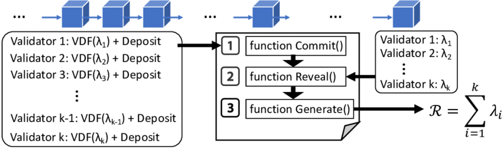
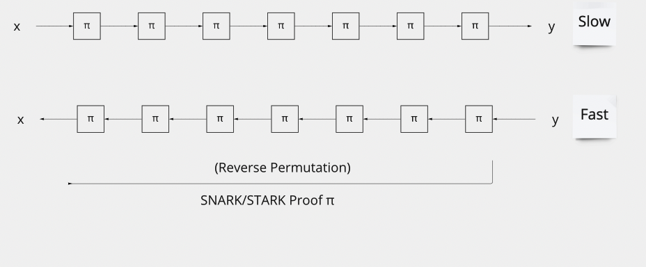

A Verifiable Delay Function (VDF) is a function that takes a long time to evaluate, cannot be sped up with parallel computation, and still produces a result that anyone can verify quickly. This post covers why distributed protocols want such a function, the basic algorithm, and how a VDF differs from a Verifiable Random Function (VRF).

# Background

Distributed protocols sometimes make computation deliberately hard or slow, so that participants are guaranteed to spend a certain amount of time or energy.

## Parallel computation

Proof of Work (PoW) is one example. Each block requires a large amount of computation, which makes it hard to rewrite the history of the ledger.

However, this work is distributed. When computing power joins or leaves the network, the network has to adjust the difficulty periodically; otherwise it cannot control the rate at which blocks are produced.

Some applications need a computation that takes the same amount of time no matter how much (distributed) computing power is thrown at it.

## Sequential computation

Unlike PoW, the goal here is a computation that can only be done efficiently in sequence. Then an efficient computer or dedicated hardware is not beaten by a supercomputer, because extra parallelism does not help.

At the same time, even though the computation itself is slow to run, it must be possible to check the result efficiently.

# What a VDF is

A VDF meets all of the goals above: it is an efficiently verifiable function that introduces a delay which parallel computation cannot shorten.

VDFs can be used, for example, to generate cryptographically secure randomness. They have been evaluated in projects such as Ethereum, Filecoin, Tezos and Zcash.

The figure below shows one way to compute a random value with a VDF. Each validator commits to $\mathrm{VDF}(\lambda_i)$ together with a deposit, then reveals its $\lambda_i$, and the final random value is

$$
\mathcal{R} = \sum_{i=1}^{k} \lambda_i
$$

Note that, for randomness, a VDF is not the same thing as a VRF (see below).

# Basic algorithm

The construction in this post uses a hash function applied sequentially, together with a recursive SNARK that proves the chain was computed correctly.

## Parameter generation

The public parameters $pp$ are the public parameters for the SNARK. The delay comes from applying a hash function $T$ times in sequence:

$$
H^{(T)}(x) = H(H(H(\cdots H(H(x))\cdots)))
$$

where $H: \{0,1\}^{256} \to \{0,1\}^{256}$ (for example, MiMC).

## Evaluation

$\mathrm{Eval}(pp, x)$ outputs $y = H^{(T)}(x)$ and a proof $\pi$, which is a recursive SNARK.

## Verification

$\mathrm{Verify}(pp, x, y, \pi)$ accepts if the SNARK proof is valid.

This whole process is a recursive SNARK: the proof that the VDF was evaluated correctly is built recursively. As the figure shows, the forward direction is slow, while the reverse direction can be computed quickly, which is one way the function differs from an ordinary hash function.

# Challenges

The construction above relies on recursive SNARKs (recursive zero-knowledge proofs), but in practice their computational cost is still high.

Because of that, research is being done on both the software and hardware side, more for zero-knowledge proofs in general than for VDFs specifically:

- New SNARK schemes, as represented by Plonky2. There is also active joint research with other organizations, such as using Proof-Carrying Data (PCD) and Incrementally Verifiable Computation built with Halo 2 and Nova to distribute the work of building proofs across different platforms.
- ASIC-based systems.

At the time these notes were written (May 2022), the zkPairing implementation announced by Applied ZKP made recursive proofs possible with schemes implemented in circom, such as Groth16, but it was still at the research and development stage.

# How a VDF differs from a VRF

VRFs are also used to generate random values, for example to select validators in Proof of Stake, but a VRF is a different thing from a VDF.

A VRF has no delay and no collaborators. It can be computed by a single party, the block producer.

The key point is that MPC-based randomness, in the VDF sense, means that multiple parties each contribute part of the random seed, and the VDF is applied in turn to prevent cheating.

# Source and references

This post is based on the bitpickers Scrapbox note [VDF(Verifiable Delay Functions)について](https://scrapbox.io/bitpickers/VDF%28Verifiable%20Delay%20Functions%29%E3%81%AB%E3%81%A4%E3%81%84%E3%81%A6). The figures are from that note.

- https://eprint.iacr.org/2018/601.pdf
- https://medium.com/starkware/presenting-veedo-e4bbff77c7ae
- https://zkproof.org/2021/11/24/practical-snark-based-vdf/
- https://techmedia-think.hatenablog.com/entry/2020/02/28/164438
- https://www.youtube.com/watch?v=dN-1q8c50q0&t=965s
